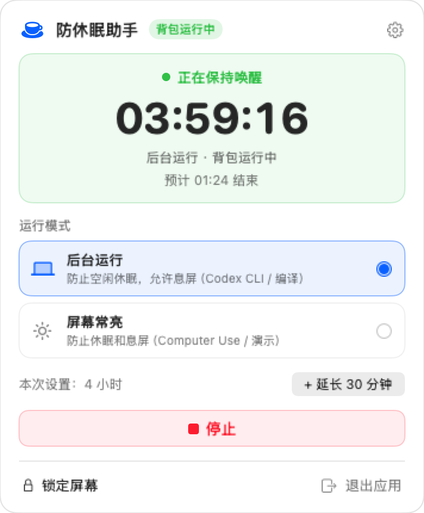
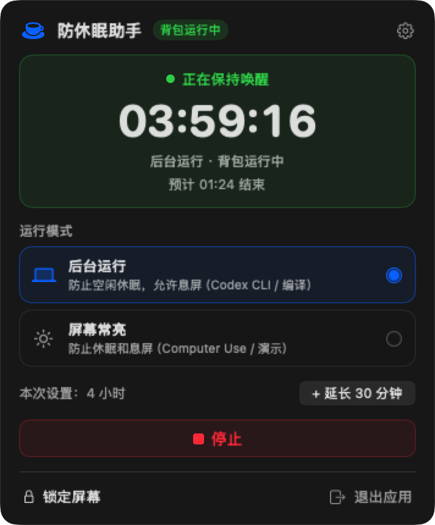

# SleepGuard

**Ultra-lightweight macOS menu bar keep-awake utility built for Vibe Coding & AI Agents.**

[中文文档](README_CN.md) · [Product Spec (PRD)](docs/PRD.md)

> Keep your battery and thermals dedicated to **Codex CLI, Claude Code, builds, servers, and AI Agents** — not an idle illuminated screen.

---

## Preview

| Idle (English) | Active Countdown (Light) | Active Countdown (Dark) |
| :---: | :---: | :---: |
|  |  |  |

---

## Why SleepGuard?

Traditional keep-awake tools were designed a decade ago to keep screens lit while reading or presenting. In the AI Agent era, most workflows run headless in the background while your MacBook travels in a sleeve, tethers to a phone hotspot, or sits locked on battery.

SleepGuard is built around first principles:
- **0.0% Idle CPU**: Powered directly by macOS native `/usr/bin/caffeinate`. The 1Hz countdown timer exists **only** while the popover is open; once closed, zero timers or background polls run.
- **Zero Orphan Processes**: Every `caffeinate` assertion is bound to the app PID via `-w <PID>`. Even if the app is force-quit, the kernel immediately tears down child assertions.
- **Remembered Config + One-Keystroke Launch**: Remembers your last mode, duration, and lock preference. Open the popover and hit `Enter` to start immediately; hit `Enter` or `Esc` while active to dismiss.
- **Two Clean, Purpose-Built Modes**:
  - **Background** (`caffeinate -i`, default): Prevents idle sleep while turning off the screen to save battery. Includes optional **Lock on Start** and opt-in **Lid-Closed Backpack Mode**.
  - **Keep Display On** (`caffeinate -di`): Keeps both system and WindowServer display rendering active — the reliable native mode for **Computer Use** (`ScreenCaptureKit` / GUI agents) and presentations. *(Tip: lower screen brightness to minimum when running Computer Use unattended.)*
- **Optional Lid-Closed Backpack Mode**: Explicit opt-in with standard macOS Touch ID / admin authorization (`pmset -a disablesleep 1`), protected by a kernel `kqueue` + `trap` watchdog that automatically restores normal sleep (`disablesleep 0`) on stop, timeout, or app termination.
- **Event-Driven Low-Battery Cutoff**: Optional battery threshold (`5%` / `10%` / `15%` / `20%`) powered by `IOKit.ps` `IOPSNotificationCreateRunLoopSource` callbacks (zero polling).

---

## Features at a Glance

- **Idle State**: Shows your remembered configuration summary (`Enter` to launch immediately), two clean mode cards, `30m / 1h / 2h / 4h (default) / ∞ / Custom` presets, and nested portable toggles (`Lock on start`, `Stay awake lid-closed`).
- **Running State**: Live `HH:MM:SS` countdown with projected end time, seamless live mode switching preserving remaining time, `+30 min` extension, low-emphasis `Stop`, and quick `Lock Screen` / `Quit` actions.
- **Native Menu Bar UX**:
  - Left-click icon: toggle Popover
  - Right-click icon: quick start, stop, lock screen, Launch at Login (`SMAppService`), preferences
  - Single-instance protection + `Cmd+,` / `Cmd+Q` / `Enter` / `Esc` keyboard support
  - Automatic `English` / `简体中文` localization

---

## Installation & Build

### Download Release
Grab the latest `.dmg` or `.zip` from [GitHub Releases](https://github.com/LaiYongqiang/SleepGuard/releases), drag `SleepGuard.app` to `/Applications`, and launch.

### Build from Source (macOS 13+)

Requires Xcode Command Line Tools (`swift` 5.10+):

```bash
git clone https://github.com/LaiYongqiang/SleepGuard.git
cd SleepGuard

# Run unit and caffeinate lifecycle tests
swift test

# Build release SleepGuard.app bundle, ZIP, and DMG in ./dist/
chmod +x scripts/build_app.sh
./scripts/build_app.sh
```

---

## Architectural Guardrails

SleepGuard strictly avoids:
1. Background polling (`ps`, `pgrep`, `pmset`) or 1Hz menu bar icon redraws when closed.
2. Silent or unrecoverable system sleep modifications.
3. Synthetic mouse/keyboard jiggling to bypass OS lock screen security.
4. `killall caffeinate` (never touches assertions owned by other apps).
5. Heavy runtimes (zero Electron, WebView, or persistent daemon helpers).

---

## License

[MIT License](LICENSE) © 2026 LaiYongqiang
