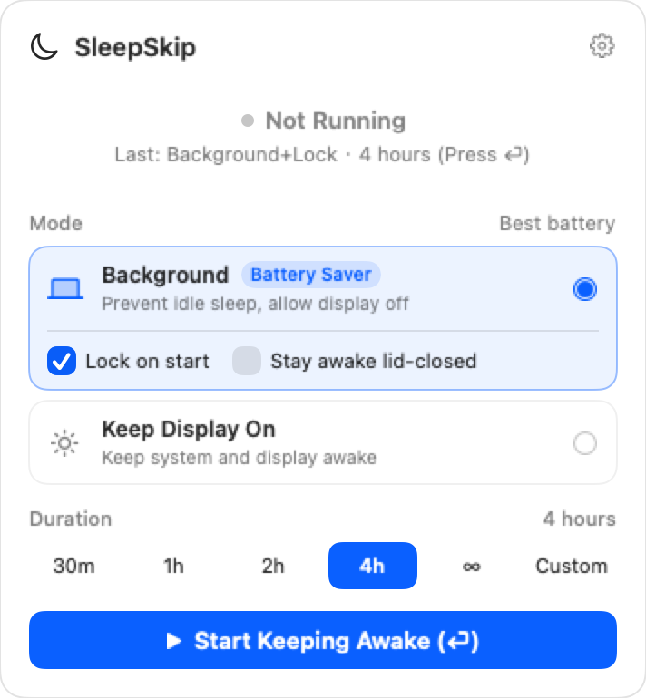
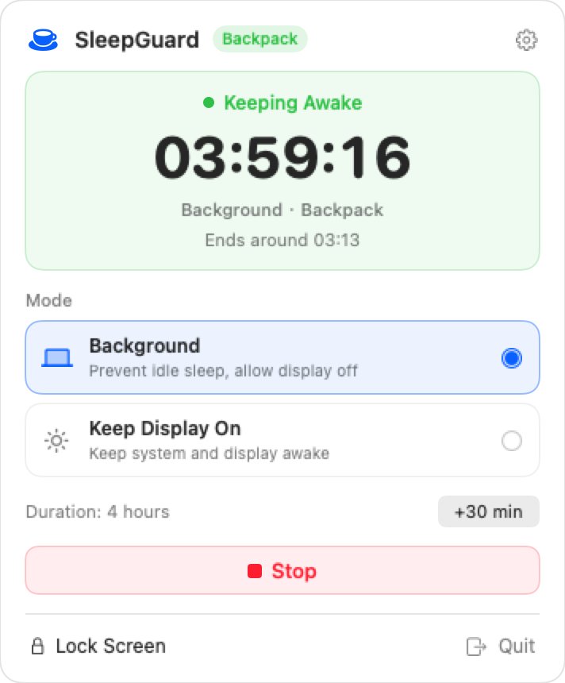
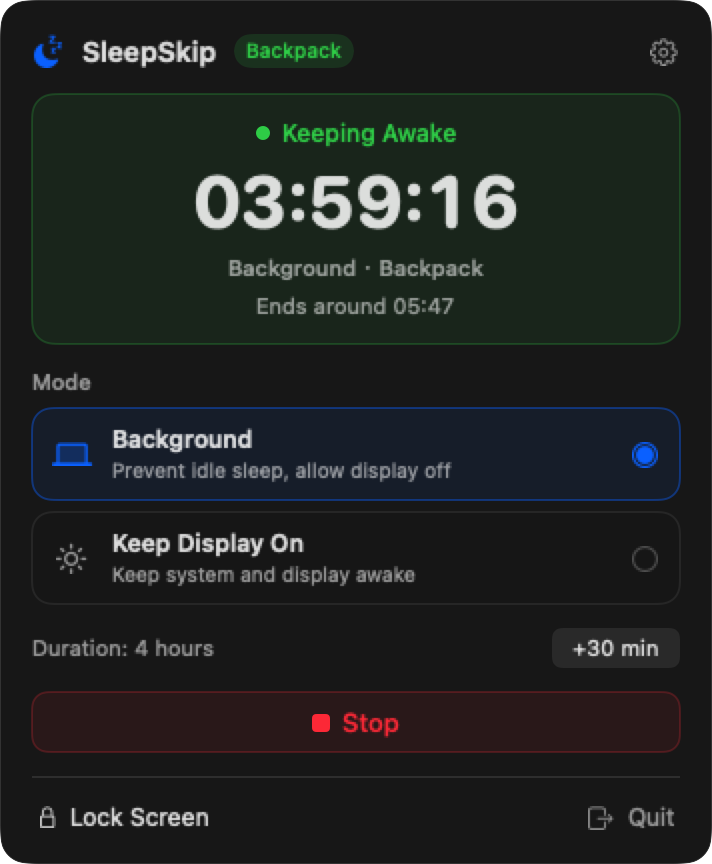
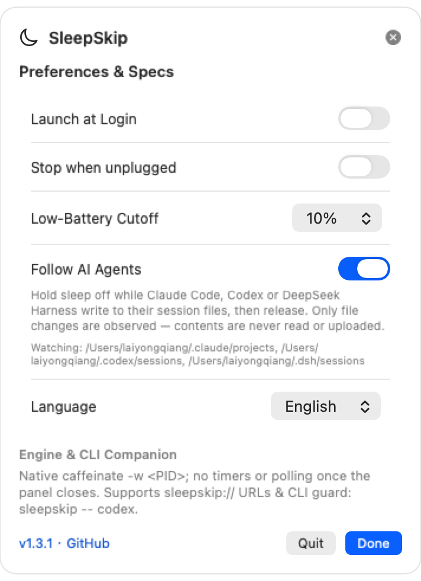

# SleepGuard

**Ultra-lightweight macOS menu bar & CLI keep-awake utility built for Vibe Coding & AI Agents.**

[中文文档](README_CN.md) · [Product Spec (PRD)](docs/PRD.md)

> Keep your battery and thermals dedicated to **Codex CLI, Claude Code, builds, servers, and AI Agents** — not an idle illuminated screen.

---

## Preview

| Idle (Light) | Active Countdown (Light) | Active Countdown (Dark) | Preferences |
| :---: | :---: | :---: | :---: |
|  |  |  |  |

---

## Why SleepGuard?

Traditional keep-awake tools were designed a decade ago to keep screens lit while reading or presenting. In the AI Agent era, most workflows run headless in the background while your MacBook travels in a sleeve, tethers to a phone hotspot, or sits locked on battery.

SleepGuard is built around first principles:
- **0.0% Idle CPU**: Powered directly by macOS native `/usr/bin/caffeinate`. The 1Hz countdown timer exists **only** while the popover is open; once closed, zero timers or background polls run.
- **Zero Orphan Processes**: Every `caffeinate` assertion is bound via `-w <PID>`. Even if force-quit, the kernel immediately tears down child assertions.
- **Remembered Config + One-Keystroke Launch**: Remembers your last mode, duration, and lock preference. Open the popover and hit `Enter` to start immediately; hit `Enter` or `Esc` to dismiss.
- **CLI Companion (`sleepguard -- <cmd>`)**: Wrap any AI Agent or build command so your Mac stays awake strictly until the task completes, synced passively via kernel `kqueue` events (`0.0%` CPU).
- **URL Scheme Automation**: Control sessions from Raycast, Alfred, or Apple Shortcuts via `sleepguard://`.
- **Two Clean, Purpose-Built Modes**:
  - **Background** (`caffeinate -i`, default): Prevents idle sleep while turning off the screen to save battery. Includes optional **Lock on Start** and opt-in **Lid-Closed Backpack Mode**.
  - **Keep Display On** (`caffeinate -di`): Keeps both system and WindowServer display rendering active — the reliable native mode for **Computer Use** (`ScreenCaptureKit` / GUI agents) and presentations. *(Tip: lower screen brightness to minimum when running Computer Use unattended.)*
- **Optional Lid-Closed Backpack Mode**: Explicit opt-in with standard macOS Touch ID / admin authorization (`pmset -a disablesleep 1`), protected by a kernel `kqueue` + `trap` watchdog that automatically restores normal sleep (`disablesleep 0`) on stop, timeout, or app termination.
- **Event-Driven Power Protection**: Pre-flight + `IOKit.ps` `IOPSNotificationCreateRunLoopSource` callbacks for optional **Low-Battery Cutoff** (`5%`–`20%`) and **Stop When Unplugged** (zero polling), delivered via native macOS notifications only on passive stops.

---

## CLI Companion & URL Automation

Link the bundled CLI binary once:

```bash
sudo ln -sf /Applications/SleepGuard.app/Contents/MacOS/SleepGuard /usr/local/bin/sleepguard
```

Usage:

```bash
# Keep Mac awake until Codex finishes (0% background polling)
sleepguard -- codex "refactor auth module"

# Keep display on for a Computer Use run, then lock screen when done
sleepguard --display --lock -- python agent.py

# Watch an already-running process by PID
sleepguard watch 12345 --lock
```

URL Scheme (`Raycast` / `Alfred` / `Shortcuts`):
- `sleepguard://start?mode=background&minutes=240&lock=1`
- `sleepguard://start?mode=display&minutes=60&lock=0`
- `sleepguard://stop`
- `sleepguard://toggle`
- `sleepguard://lock`

---

## Installation & Build

### Homebrew (Recommended — installs both App & `sleepguard` CLI)

```bash
brew install --cask --no-quarantine laiyongqiang/tap/sleepguard
```

### Download Release (Universal: Apple Silicon + Intel)

1. Download `SleepGuard-1.1.0-macOS-universal.dmg` from [GitHub Releases](https://github.com/LaiYongqiang/SleepGuard/releases) and drag `SleepGuard.app` to `/Applications`.
2. Since release builds are ad-hoc signed without a paid Apple Developer ID, run once if Gatekeeper blocks first launch:
   ```bash
   xattr -cr /Applications/SleepGuard.app
   ```

### Build from Source (macOS 13+)

Requires Xcode Command Line Tools (`swift` 5.10+):

```bash
git clone https://github.com/LaiYongqiang/SleepGuard.git
cd SleepGuard

# Run unit and caffeinate lifecycle tests
./scripts/verify.sh

# Build Universal SleepGuard.app bundle, ZIP, and DMG in ./dist/
chmod +x scripts/build_app.sh
./scripts/build_app.sh
```

---

## Architectural Guardrails

SleepGuard strictly avoids:
1. Background polling (`ps`, `pgrep`, `pmset`) or 1Hz menu bar icon redraws when closed.
2. Silent or unrecoverable system sleep modifications.
3. Synthetic mouse/keyboard jiggling to bypass OS lock screen security.
4. `killall caffeinate` (never touches assertions owned by other apps).
5. Heavy runtimes (zero Electron, WebView, or persistent daemon helpers).

---

## License

[MIT License](LICENSE) © 2026 LaiYongqiang
