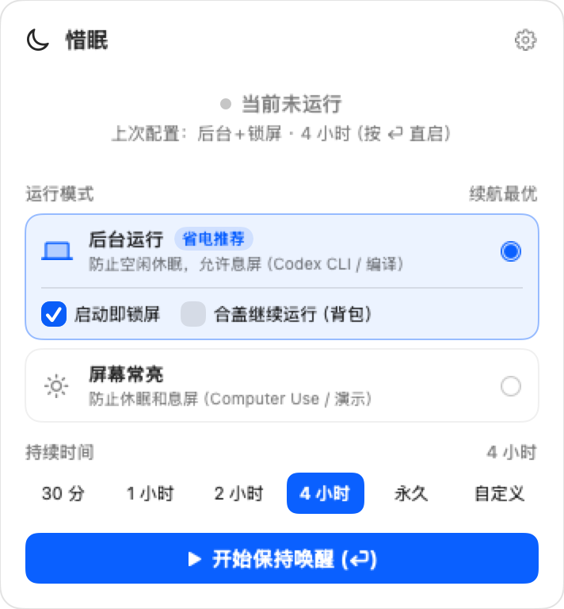
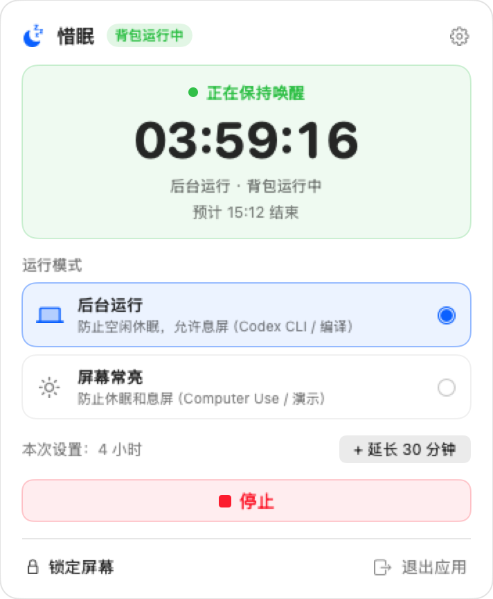
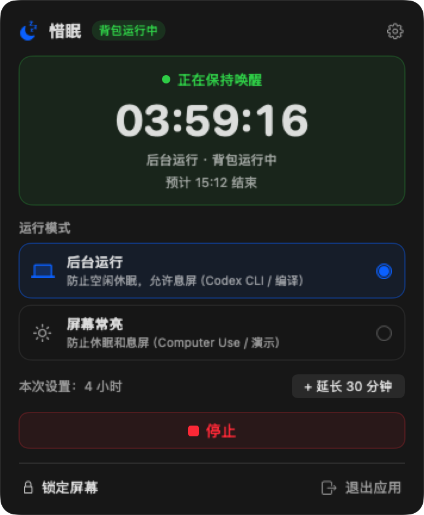
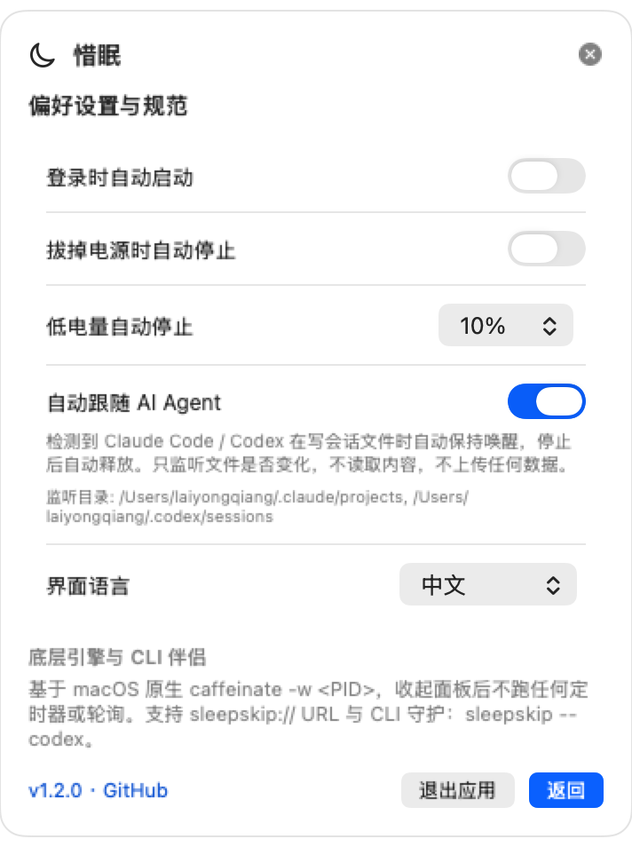

# SleepSkip（惜眠）

**零定时器，零轮询，零空耗。** —— 专为 Vibe Coding 与 AI Agent 时代打造的极致轻量 macOS 原生菜单栏 + CLI 防休眠工具。

[English](README.md) · [产品需求文档 (PRD)](docs/PRD.md)

> Agent 没干完，Mac 不许睡。把有限的电池电量留给真正干活的 **Codex CLI、Claude Code、构建任务与后台服务**，而不是浪费在无人观看的屏幕上。

名字里有两层意思：**skip** 掉不必要的睡眠，**spare** 下不该浪费的电量。中文名「惜眠」——把睡眠省着用。

---

## 界面预览

| 待机状态（浅色） | 运行中倒计时（浅色） | 运行中倒计时（深色） | 偏好设置 |
| :---: | :---: | :---: | :---: |
|  |  |  |  |

---

## 核心特色

- **收起面板后零定时器、零轮询**：直接基于 macOS 原生 `/usr/bin/caffeinate`，倒计时定时器仅在 Popover 展开可见时运行。[实测](docs/PERFORMANCE.md)：空闲 120 秒仅消耗 0.09–0.24 毫秒 CPU——和一个只画菜单栏图标、什么都不做的 App 处于同一量级。
- **零孤儿进程守护**：所有 `caffeinate` 子进程均通过 `-w <APP_PID>` 绑定生命周期，无论正常退出还是意外强杀，系统内核自动回收断言。
- **记忆配置 + 一次回车直启**：自动记住上一次模式、锁屏/合盖选项与时长。打开面板按 `Enter` 即可按上次配置启动；支持不锁屏启动时留在本面板显示大号倒计时，按 `Enter` 或 `Esc` 随时收起。
- **CLI 伴侣守护（`sleepskip -- <cmd>`）**：直接包裹终端中的 Agent 或编译命令，任务运行期间防休眠，任务结束瞬间释放断言并可选自动锁屏，菜单栏通过内核 `kqueue` 被动同步状态（实测：10 秒任务总共消耗 10 毫秒 CPU）。
- **URL Scheme 快捷联动**：支持 `sleepskip://start` / `stop` / `toggle` / `lock`，轻松接入 Raycast、Alfred 与 macOS 快捷指令。
- **两种纯正运行模式**：
  - **后台运行**（`caffeinate -i`，默认）：阻止系统空闲睡眠、允许屏幕熄灭省电。支持记忆开关「启动即锁屏」与可选「合盖继续运行（背包模式）」。
  - **屏幕常亮**（`caffeinate -di`）：保持系统与桌面窗口渲染活跃，适合 **Computer Use 桌面操控**、投屏演示与日志监看。（*跑 Computer Use 时建议手动把屏幕亮度调至最低以兼顾省电*）
- **真正在背包里可用的「合盖模式」**：默认关闭、显式勾选并经系统 Touch ID / 管理员授权执行 `pmset -a disablesleep 1`，配合内核 `kqueue` + `trap` 守护机制，停止、超时或应用崩溃退出时自动恢复 `disablesleep 0`。
- **零轮询电源安全保护**：基于 `IOKit.ps` `IOPSNotificationCreateRunLoopSource` 事件回调（默认低于 `10%` 且未充电时自动停止；可选「拔掉电源时自动停止」；并在启动前预检避免无效授权弹窗）。仅在定时到期或电源保护触发时发送原生系统通知。
- **自动跟随 AI Agent**（默认开启，可一键关闭）：用 FSEvents 监听 Agent 的会话目录（`~/.claude/projects`、`~/.codex/sessions`），它们写文件时保持唤醒，停笔 5 分钟后自动释放。实测开销是 **每 20 秒约 0.2 毫秒 CPU**，唤醒次数与菜单栏图标本身相当——作为对比，进程轮询每 30 秒约 160 毫秒且每秒唤醒一次，已否决。只监听文件是否变化，从不读取内容。手动会话永远优先；单次自动会话有 2 小时硬上限，避免误挂整夜。默认开启，装完即可用；首次打开面板会说明监听了哪两个目录，开关在偏好设置里。

---

## CLI 伴侣与 URL 自动化

建立一次软链接即可在终端全局使用：

```bash
sudo ln -sf /Applications/SleepSkip.app/Contents/MacOS/SleepSkip /usr/local/bin/sleepskip
```

常用命令：

```bash
# 让 Mac 在 Codex 运行期间保持唤醒，结束后自动恢复正常休眠
sleepskip -- codex "refactor auth module"

# 运行 Computer Use 任务期间保持屏幕常亮，结束后立即锁屏
sleepskip --display --lock -- python agent.py

# 跟随已在运行中的进程 PID
sleepskip watch 12345 --lock
```

URL Scheme（适用 Raycast / Alfred / 快捷指令）：
- `sleepskip://start?mode=background&minutes=240&lock=1`
- `sleepskip://start?mode=display&minutes=60&lock=0`
- `sleepskip://stop`
- `sleepskip://toggle`
- `sleepskip://lock`

---

## 实测资源占用

数据可用 `swift scripts/bench_idle.swift "$(pgrep -x SleepSkip)" 120` 复现；完整的测量方法与被否决的方案见 [docs/PERFORMANCE.md](docs/PERFORMANCE.md)。

| 状态 | 每 120 秒 CPU | 强制唤醒 |
| :--- | ---: | ---: |
| 空闲、面板收起 | 0.09–0.24 毫秒 | 3–11 次 |
| 自动跟随开启、Agent 正在写入 | 180 秒 0.73 毫秒 | 12 次 |
| 面板打开（1Hz 倒计时） | 60 秒 1.3 毫秒 | 约 60 次 |

作为参照：一个**什么都不做、只画菜单栏图标**的空 AppKit 应用，空闲 120 秒也需要 0.035–0.142 毫秒。SleepSkip 处于同一区间——它自身的逻辑没有在系统开销之上增加任何可测量的负担。这也是为什么我们说的是「零定时器、零轮询」而不是「零唤醒」：任何菜单栏应用都无法诚实地承诺后者。

---

## 安装与从源码构建（macOS 13+）

### Homebrew 一键安装（推荐：同时安装 App 与 `sleepskip` CLI）

```bash
brew install --cask laiyongqiang/tap/sleepskip
```

Homebrew 会把 `SleepSkip.app` 装进 `/Applications`，并链接好 `sleepskip` 命令。命令名用 `sleepskip` 而不是 `skip`，是因为 Homebrew 里的 `skip` 已经被 skip.tools 占用。


### 下载 Release（通用二进制：Apple Silicon + Intel）

1. 前往 [GitHub Releases](https://github.com/LaiYongqiang/SleepSkip/releases) 下载 `SleepSkip-1.2.0-macOS-universal.dmg`，拖入 `/Applications`。
2. 当前开源发行包采用本地 Ad-hoc 签名；若首次双击遇 macOS Gatekeeper 拦截，在终端执行一次：
   ```bash
   xattr -cr /Applications/SleepSkip.app
   ```

### 从源码构建

仅需安装 Xcode Command Line Tools（Swift 5.10+），无需完整 Xcode：

```bash
git clone https://github.com/LaiYongqiang/SleepSkip.git
cd SleepSkip

# 运行状态机单测与 caffeinate -w 生命周期测试
./scripts/verify.sh

# 构建 Universal (arm64+x86_64) SleepSkip.app、ZIP 与 DMG（输出到 ./dist/）
chmod +x scripts/build_app.sh
./scripts/build_app.sh
```

---

## 架构红线

1. 严禁 Popover 不可见时的后台定时器、状态栏每秒重绘或 `ps`/`pmset` 轮询。
2. 严禁静默或无自动恢复兜底地修改系统电源配置。
3. 严禁使用模拟鼠标微动/虚拟按键绕过系统锁屏安全机制。
4. 严禁调用 `killall caffeinate` 误杀其他应用断言。
5. 严禁引入 Electron、WebView 或重型后台常驻服务。

---

## 开源协议

[MIT License](LICENSE) © 2026 LaiYongqiang
